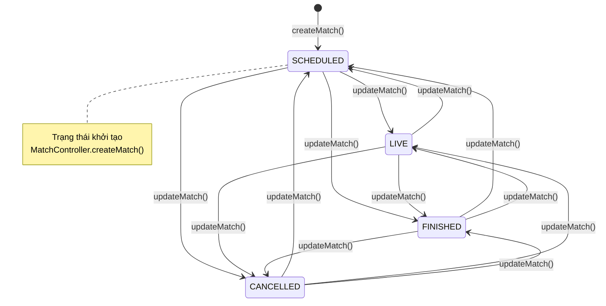
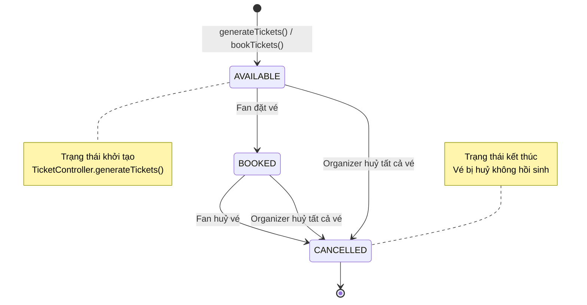
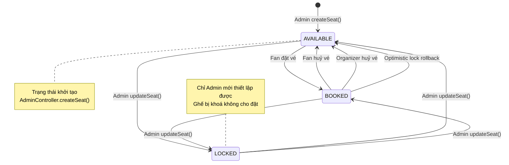
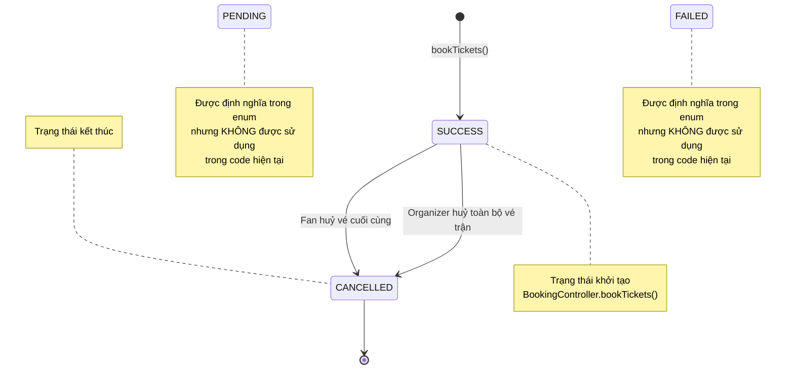

# State Machine Diagrams — Stadium Ticket Booking Simulation

> [!NOTE]
> Toàn bộ sơ đồ dưới đây được trích xuất **100% từ mã nguồn thực tế** trong repo. Mỗi chuyển trạng thái đều có tham chiếu đến file và phương thức cụ thể trong code.

---

## 1. Match — MatchStatus

Vòng đời của một trận đấu từ khi tạo đến khi kết thúc hoặc huỷ bỏ.

**Các trạng thái:** `SCHEDULED`, `LIVE`, `FINISHED`, `CANCELLED`



| Chuyển trạng thái | Trigger | Source code |
|:---|:---|:---|
| `[*] → SCHEDULED` | Tạo trận đấu mới | `MatchController.createMatch()` — `newMatch.setStatus(MatchStatus.SCHEDULED)` |
| `ANY → ANY` | Organizer cập nhật trận | `MatchController.updateMatch()` — `match.setStatus(status)` **(không có guard điều kiện)** |

> [!WARNING]
> Code hiện tại **không có guard condition** trong `updateMatch()`. Phương thức nhận bất kỳ giá trị `MatchStatus` nào và gán trực tiếp, nghĩa là tất cả 12 chuyển trạng thái đều được phép kể cả chiều ngược (VD: `FINISHED → SCHEDULED`).

---

## 2. Ticket — TicketStatus

Vòng đời của một chiếc vé từ khi được sinh ra đến khi bị huỷ.

**Các trạng thái:** `AVAILABLE`, `BOOKED`, `CANCELLED`



| Chuyển trạng thái | Trigger | Source code |
|:---|:---|:---|
| `[*] → AVAILABLE` | Organizer sinh vé / Fan booking tạo vé mới | `TicketController.generateTickets()` — `new Ticket(..., TicketStatus.AVAILABLE)` |
| `AVAILABLE → BOOKED` | Fan đặt vé thành công | `BookingController.bookTickets()` — `ticket.setStatus(TicketStatus.BOOKED)` |
| `BOOKED → CANCELLED` | Fan huỷ vé cá nhân | `BookingController.cancelTicket()` — guard: `ticket.getStatus() != TicketStatus.BOOKED → return false` → `ticket.setStatus(TicketStatus.CANCELLED)` |
| `BOOKED → CANCELLED` | Organizer huỷ toàn bộ vé trận đấu | `TicketController.cancelTickets()` — `ticket.setStatus(TicketStatus.CANCELLED)` |
| `AVAILABLE → CANCELLED` | Organizer huỷ toàn bộ vé trận đấu | `TicketController.cancelTickets()` — set CANCELLED rồi xoá khỏi danh sách |

> [!IMPORTANT]
> Sau khi sửa lỗi (commit `cd52cd0`), `generateTickets()` kiểm tra `match.getStatus() == MatchStatus.CANCELLED` thì dừng, và **bỏ qua vé `CANCELLED`/`BOOKED`** — không hồi sinh vé đã huỷ.

---

## 3. Seat — SeatStatus

Vòng đời của một ghế ngồi trong sân vận động.

**Các trạng thái:** `AVAILABLE`, `LOCKED`, `BOOKED`



| Chuyển trạng thái | Trigger | Source code |
|:---|:---|:---|
| `[*] → AVAILABLE` | Admin tạo ghế mới | `AdminController.createSeat()` — `new Seat(..., SeatStatus.AVAILABLE, 0)` |
| `AVAILABLE → BOOKED` | Fan đặt vé (Optimistic) | `BookingController.bookTickets()` — `new Seat(..., SeatStatus.BOOKED, expectedVersion)` |
| `AVAILABLE → BOOKED` | Fan đặt vé (Synchronized/File Lock/No Lock) | `BookingController.bookTickets()` — `seat.setStatus(SeatStatus.BOOKED)` |
| `BOOKED → AVAILABLE` | Fan huỷ vé | `BookingController.cancelTicket()` — `seat.setStatus(SeatStatus.AVAILABLE)` |
| `BOOKED → AVAILABLE` | Organizer huỷ toàn bộ vé | `TicketController.cancelTickets()` — `seat.setStatus(SeatStatus.AVAILABLE)` |
| `BOOKED → AVAILABLE` | Optimistic lock thất bại (rollback) | `BookingController.bookTickets()` finally block — `new Seat(..., SeatStatus.AVAILABLE, bookedVersion)` |
| `ANY → ANY` | Admin cập nhật ghế | `AdminController.updateSeat()` — `seat.setStatus(status)` **(không có guard)** |

---

## 4. BookingTransaction — TransactionStatus

Vòng đời của một giao dịch đặt vé.

**Các trạng thái:** `PENDING`, `SUCCESS`, `FAILED`, `CANCELLED`



| Chuyển trạng thái | Trigger | Source code |
|:---|:---|:---|
| `[*] → SUCCESS` | Fan đặt vé thành công | `BookingController.bookTickets()` — `new BookingTransaction(..., TransactionStatus.SUCCESS)` |
| `SUCCESS → CANCELLED` | Fan huỷ vé cuối cùng trong giao dịch | `BookingController.cancelTicket()` — guard: `remainingTickets == 0` → `originalTransaction.setStatus(TransactionStatus.CANCELLED)` |
| `SUCCESS → CANCELLED` | Organizer huỷ toàn bộ vé trận đấu | `TicketController.cancelTickets()` — `txn.setStatus(TransactionStatus.CANCELLED)` |

> [!NOTE]
> `PENDING` và `FAILED` được khai báo trong enum `TransactionStatus` nhưng **không có bất kỳ dòng code nào** gán hai trạng thái này cho bất kỳ giao dịch nào. Chúng tồn tại như trạng thái dự phòng cho mở rộng tương lai.

---

## 5. Account — AccountStatus

### 5a. Fan Account

**Các trạng thái:** `PENDING`, `ACTIVE`, `REJECTED`, `BLOCKED`

```mermaid
stateDiagram-v2
    [*] --> ACTIVE : registerFan()

    ACTIVE --> REJECTED : Admin rejectFanAccount()
    REJECTED --> ACTIVE : Admin approveFanAccount()

    note right of ACTIVE
        Trạng thái khởi tạo cho Fan
        AuthController.registerFan()
    end note

    note left of BLOCKED
        Được định nghĩa trong enum
        Được kiểm tra khi đăng nhập
        Nhưng KHÔNG có code nào
        gán trạng thái này
    end note
```

### 5b. Organizer Account

```mermaid
stateDiagram-v2
    [*] --> PENDING : registerOrganizer()

    PENDING --> ACTIVE : Admin approveOrganizer()
    PENDING --> REJECTED : Admin rejectOrganizer()

    ACTIVE --> REJECTED : Admin rejectOrganizerAccount()
    REJECTED --> ACTIVE : Admin approveOrganizerAccount()

    note right of PENDING
        Trạng thái khởi tạo cho Organizer
        AuthController.registerOrganizer()
        Cần Admin duyệt mới được đăng nhập
    end note

    note left of ACTIVE
        Trạng thái duy nhất cho phép
        đăng nhập vào hệ thống
    end note

    note left of BLOCKED
        Được định nghĩa trong enum
        nhưng KHÔNG có code nào
        gán trạng thái này
    end note
```

| Chuyển trạng thái | Áp dụng cho | Trigger | Source code |
|:---|:---|:---|:---|
| `[*] → ACTIVE` | Fan | Đăng ký tài khoản Fan | `AuthController.registerFan()` — `newFan.setStatus(AccountStatus.ACTIVE)` |
| `[*] → PENDING` | Organizer | Đăng ký tài khoản Organizer | `AuthController.registerOrganizer()` — `newOrg.setStatus(AccountStatus.PENDING)` |
| `PENDING → ACTIVE` | Organizer | Admin duyệt đơn | `AuthController.approveOrganizer()` / `AdminController.approveOrganizerAccount()` |
| `PENDING → REJECTED` | Organizer | Admin từ chối đơn | `AuthController.rejectOrganizer()` / `AdminController.rejectOrganizerAccount()` |
| `ACTIVE → REJECTED` | Fan / Organizer | Admin từ chối tài khoản | `AdminController.rejectFanAccount()` / `rejectOrganizerAccount()` |
| `REJECTED → ACTIVE` | Fan / Organizer | Admin phê duyệt lại | `AdminController.approveFanAccount()` / `approveOrganizerAccount()` |

> [!NOTE]
> **Guard đăng nhập:** Chỉ tài khoản có trạng thái `ACTIVE` mới được phép đăng nhập. Code kiểm tra: `fan.getStatus() == AccountStatus.ACTIVE && fan.validatePassword(pass)` trong `AuthController`.

---

## Tổng hợp tất cả State Machine

| Entity | Trạng thái | Khởi tạo | Kết thúc | Số chuyển trạng thái |
|:---|:---|:---|:---|:---|
| **Match** | SCHEDULED, LIVE, FINISHED, CANCELLED | SCHEDULED | FINISHED, CANCELLED *(logic)* | 12 *(không có guard)* |
| **Ticket** | AVAILABLE, BOOKED, CANCELLED | AVAILABLE | CANCELLED | 3 |
| **Seat** | AVAILABLE, LOCKED, BOOKED | AVAILABLE | *(tuần hoàn)* | 3 nghiệp vụ + admin |
| **Transaction** | PENDING, SUCCESS, FAILED, CANCELLED | SUCCESS | CANCELLED | 1 *(PENDING, FAILED chưa dùng)* |
| **Account (Fan)** | PENDING, ACTIVE, REJECTED, BLOCKED | ACTIVE | *(tuần hoàn)* | 2 *(BLOCKED chưa dùng)* |
| **Account (Organizer)** | PENDING, ACTIVE, REJECTED, BLOCKED | PENDING | *(tuần hoàn)* | 4 *(BLOCKED chưa dùng)* |

> [!TIP]
> Các trạng thái được khai báo nhưng chưa sử dụng (`PENDING`, `FAILED` của Transaction; `BLOCKED` của Account) cho thấy hệ thống đã thiết kế mở rộng sẵn, nhưng logic xử lý tương ứng chưa được triển khai trong phiên bản hiện tại.
