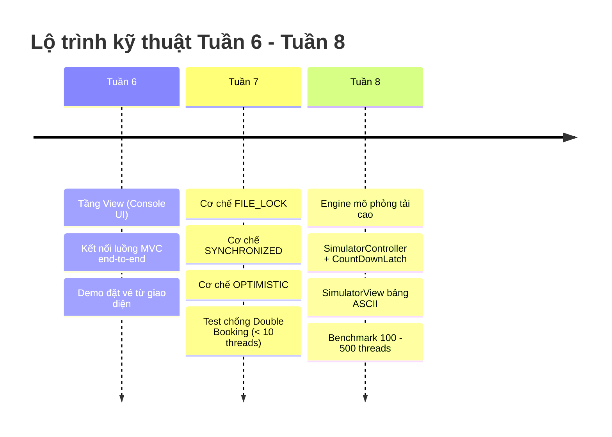

# BẢNG PHÂN CÔNG NHIỆM VỤ DỰ ÁN LAB211 (TUẦN 6, 7, 8)
## HỆ THỐNG MÔ PHỎNG ĐẶT VÉ SÂN VẬN ĐỘNG (STADIUM TICKET BOOKING SIMULATION)

> **Nhóm thực hiện:** Nhóm 6  
> **Leader & Reviewer:** Siêu  
> **Các thành viên:** Kiệt, Nam, Huy, Văn, Siêu  
> **Giai đoạn trọng tâm:** Tuần 6 (View Layer & MVC Wiring), Tuần 7 (Synchronization Mechanisms), Tuần 8 (Simulator Tool & Stress Test)  
> **Căn cứ thiết kế:** Đề tài gốc (`LAB211_TicketBooking_De_Tai.docx.pdf`), Sơ đồ lớp chuẩn (`mermaid-class-diagram.docx`), Thư viện dữ liệu CSV (`data/*.csv`)

---

## I. TỔNG QUAN LỘ TRÌNH 3 TUẦN (ROADMAP T6 - T7 - T8)

* **Tuần 6 (🖥️ View Layer + MVC Wiring):**
  * Xây dựng đầy đủ các View console theo mô hình MVC: `MainView`, `AuthView`, `MatchView`, `SeatMapView`, `BookingView`, `OrganizerView`, `AdminView`.
  * Đấu nối luồng tương tác giữa `View ↔ Controller ↔ Repository ↔ Model`.
  * **Deliverable T6:** Chạy demo hoàn chỉnh luồng đặt vé đơn luồng từ UI console (Đăng nhập -> Xem danh sách trận đấu -> Xem sơ đồ ghế ASCII -> Đặt vé -> Xem lịch sử vé).
* **Tuần 7 (🔒 Synchronization Mechanisms):**
  * Hiện thực 3 cơ chế đồng bộ hóa giải quyết bài toán chống **Double Booking** (xung đột đặt cùng 1 ghế trong Flash Sale):
    1. `FILE_LOCK`: Java NIO `FileLock` trên file `seats.csv`.
    2. `SYNCHRONIZED`: Khối `synchronized` bảo vệ critical section đặt vé.
    3. `OPTIMISTIC`: Optimistic Locking với trường `version` trong `Seat` và vòng lặp conflict retry.
  * **Deliverable T7:** Cả 3 cơ chế hoạt động đúng. Không xảy ra tình trạng double booking khi test đồng thời với < 10 threads thủ công.
* **Tuần 8 (🚀 Simulator Tool & Stress Test):**
  * Xây dựng công cụ kiểm thử tải mô phỏng bán vé Flash Sale: `SimulatorController` kết hợp `CountDownLatch` và `ExecutorService` (100 – 500 threads).
  * Hiện thực `SimulatorView` in bảng so sánh hiệu năng ASCII trực quan (Throughput, Double Booking Rate, Thời gian thực thi).
  * Ghi nhận và lưu lịch sử đo đạc vào `simulation_results.csv` qua `SimulationResultRepository`.
  * **Deliverable T8:** Demo simulator 500 threads. Bảng kết quả so sánh đúng format hiển thị trên màn hình.

---

## II. MA TRẬN PHÂN CÔNG CHI TIẾT THEO TỪNG THÀNH VIÊN (TUẦN 6, 7, 8)

### 1. Bảng Phân Công Tuần 6: View Layer & MVC Wiring (Console UI)

| Thành viên | Domain chuyên trách | Tầng (Layer) | Class & Phương thức phân công (Chuẩn Class Diagram) | Nhiệm vụ & Deliverable chi tiết |
| :--- | :--- | :--- | :--- | :--- |
| **Siêu** *(Leader)* | Trận đấu & Core Routing | View / Core | **`MainView`** - `start(): void` - `displayGuestMenu(): void` - `displayFanMenu(): void` - `displayOrganizerMenu(): void` - `displayAdminMenu(): void`  **`MatchView`** - `displayMatches(matches: List<Match>): void` - `displayMatchDetails(match: Match): void` - `displayCreateMatchForm(): void` - `displayUpdateMatchForm(): void` - `promptSearchKeyword(): String` - `promptFilterCriteria(): MatchFilter` | - Thiết kế khung menu điều hướng trung tâm phân quyền theo vai trò (GUEST, FAN, ORGANIZER, ADMIN). - Hiện thực giao diện xem, tìm kiếm và lọc trận đấu bóng đá. - Đấu nối `MatchView` với `MatchController`. - **Deliverable:** Menu chính hoạt động mượt mà, phân quyền chuẩn. |
| **Kiệt** | Account & Auth | View | **`AuthView`** - `displayLoginForm(): void` - `displayFanRegisterForm(): void` - `displayOrganizerRegisterForm(): void` - `displayProfile(account: Account): void` - `displayChangePasswordForm(): void` | - Xây dựng các form nhập liệu: đăng nhập, đăng ký Fan, đăng ký Ban tổ chức, xem thông tin cá nhân và đổi mật khẩu. - Đấu nối trực tiếp với `AuthController`. - Xử lý bắt lỗi nhập dữ liệu (validation rỗng, định dạng email, số điện thoại). - **Deliverable:** Luồng xác thực đăng nhập/đăng ký chạy hoàn chỉnh trên console. |
| **Nam** | Sân & Ghế | View | **`SeatMapView`** - `displaySeatMap(asciiMap: String): void` - `displayAvailableSeats(seats: List<Seat>): void`  **`StadiumView`** *(Hoàn thiện)* - `displayStadiumList(stadiums: List<Stadium>): void` - `displaySectionList(stadiumId: String, sections: List<SeatSection>): void` - `displaySectionDetails(section: SeatSection, count: int): void` | - Hiện thực hiển thị sơ đồ ghế ASCII trực quan nhận chuỗi từ `StadiumController.buildSeatMap`. - Hiển thị bảng danh sách sân vận động và khán đài với định dạng cột ngay ngắn. - Đấu nối View với `StadiumController`. - **Deliverable:** Sơ đồ ghế hiển thị rõ ràng ký hiệu trạng thái `[O]`, `[X]`, `[L]`. |
| **Huy** | Vé & Giao dịch | View | **`BookingView`** - `displayBookingForm(seats: List<Seat>): void` - `showBookingResult(success: boolean, msg: String): void` - `displayBookingHistory(txns: List<BookingTransaction>): void` - `displayCancelTicketForm(): void`  **`OrganizerView`** - `displayPricingConfigForm(): void` - `displayGenerateTicketsForm(): void` - `displaySalesReport(salesData: Map<String, Object>): void` | - Xây dựng form đặt vé (nhập danh sách mã ghế tối đa 4 vé/lần). - Hiển thị kết quả thanh toán, bảng lịch sử giao dịch và form hủy vé. - Xây dựng giao diện báo cáo doanh thu vé cho Organizer. - Đấu nối với `BookingController` và `TicketController`. - **Deliverable:** Luồng chọn ghế -> đặt vé -> in biên lai vé hoàn tất. |
| **Văn** | Test UI & Simulator Prep | Test / View | **`EndToEndBookingTest`** - Kiểm thử tích hợp UI flow - Chuẩn bị khung sườn UI cho module Simulator | - Viết kịch bản kiểm thử luồng console UI từ đầu đến cuối: Login Fan -> Xem trận -> Chọn khán đài -> Đặt vé -> Kiểm tra file CSV. - Hỗ trợ tích hợp liên tầng và kiểm tra bắt lỗi người dùng. - **Deliverable:** Bộ test case end-to-end pass 100%. |

---

### 2. Bảng Phân Công Tuần 7: Synchronization Mechanisms (Chống Double Booking)

| Thành viên | Domain chuyên trách | Tầng (Layer) | Class & Phương thức phân công | Nhiệm vụ & Deliverable chi tiết |
| :--- | :--- | :--- | :--- | :--- |
| **Văn** *(Chủ trì Concurrency)* | Simulation & Concurrency | Repository / Controller | **`BookingController`** & **`SeatRepository`** - Triển khai cơ chế `SYNCHRONIZED` - Triển khai cơ chế `OPTIMISTIC` - Phương thức: `SeatRepository.updateWithOptimisticLock(Seat seat, int expectedVersion)` | - **Cơ chế SYNCHRONIZED:** Áp dụng khối khóa đồng bộ `synchronized` trên monitor quản lý ghế, bảo vệ critical section khi kiểm tra và gán trạng thái ghế. - **Cơ chế OPTIMISTIC:** Hiện thực logic kiểm tra trường `version` trong `Seat`, chỉ ghi nhận thành công khi version trong file khớp với `expectedVersion`; xây dựng vòng lặp retry (conflict retry loop) khi đụng độ. - Viết Harness Test chạy song song 2 - 10 threads đặt cùng 1 ghế. - **Deliverable:** 2 cơ chế SYNCHRONIZED và OPTIMISTIC chạy chuẩn xác, 0 double booking. |
| **Nam** | Sân & Ghế (NIO FileLock) | Repository | **`SeatRepository`** - `acquireFileLock(): void` - `releaseFileLock(): void` | - Hiện thực cơ chế **`FILE_LOCK`** sử dụng `java.nio.channels.FileChannel` và `FileLock` trên file `seats.csv`. - Đảm bảo FileLock có cơ chế giải phóng an toàn trong khối `finally`, tránh tình trạng treo file trên OS Windows/Linux. - Xử lý tương thích đa luồng truy cập cùng tiến trình. - **Deliverable:** `FILE_LOCK` bảo vệ thành công file CSV trước ghi đè đồng thời. |
| **Huy** | Vé & Giao dịch | Controller | **`BookingController`** - `bookTickets(fanId: String, matchId: String, seatIds: List<String>, mech: SynchronizationMechanism): boolean` | - Nâng cấp toàn diện phương thức `bookTickets` để kích hoạt linh hoạt 4 cơ chế theo tham số `mech`:   1. `NO_LOCK`: Baseline không khóa (cho phép race condition xảy ra để đối chứng).   2. `FILE_LOCK`: Kích hoạt qua `seatRepository.acquireFileLock()`.   3. `SYNCHRONIZED`: Điều phối qua critical section.   4. `OPTIMISTIC`: Điều phối qua `updateWithOptimisticLock` + retry. - Đảm bảo tính nguyên tử: Tạo `BookingTransaction` và `Ticket` đồng bộ. - **Deliverable:** Controller hỗ trợ trơn tru cả 4 cơ chế. |
| **Kiệt** | Account & Data Safety | Model / Repo | **`TransactionRepository`** & **`TicketRepository`** - Kiểm toán tính toàn vẹn dữ liệu giao dịch đa luồng | - Rà soát quá trình sinh mã giao dịch `transactionId` và `ticketId` khi nhiều luồng cùng gọi đồng thời, tránh trùng mã ID. - Đảm bảo file `transactions.csv` và `tickets.csv` không bị hỏng dòng (corrupted lines) khi ghi dồn dập. - **Deliverable:** File CSV dữ liệu toàn vẹn sau khi thử nghiệm luồng. |
| **Siêu** *(Leader)* | Reviewer & Verification | Reviewer / Core | **`ConcurrencyAuditTest`** - Toàn bộ mã nguồn Tuần 7 | - Audit thread-safety: Bắt buộc tuân thủ 100% `this.`, cấm dùng `static` state/collection lưu tạm dữ liệu gây race condition ngầm. - Kiểm tra các điểm giải phóng khóa (release lock) không bị bỏ sót khi có exception. - **Deliverable:** Báo cáo Audit đạt chuẩn 🟢 APPROVE cho toàn bộ tầng Synchronization. |

---

### 3. Bảng Phân Công Tuần 8: Simulator Tool & Stress Test (100 - 500 Threads)

| Thành viên | Domain chuyên trách | Tầng (Layer) | Class & Phương thức phân công (Chuẩn Class Diagram) | Nhiệm vụ & Deliverable chi tiết |
| :--- | :--- | :--- | :--- | :--- |
| **Văn** *(Chủ trì Simulator)* | Simulation Engine | Controller | **`SimulatorController`** - `threadCount: int` - `totalRequests: int` - `lockingMechanism: SynchronizationMechanism` - `runConcurrencyTest(mech: SynchronizationMechanism, threads: int, reqs: int): SimulationResult` - `executeConcurrentTasks(latch: Object, pool: Object): void` - `calculateThroughput(successCount: int, durationMs: long): double` - `calculateDoubleBookingRate(doubleBookings: int, totalSuccess: int): double`  **`SimulationResultRepository`** - `findByMechanism(mech: SynchronizationMechanism): List<SimulationResult>` - `getLatestResult(): SimulationResult` | - Xây dựng Engine bắn tải mô phỏng bán vé Flash Sale sử dụng `ExecutorService` (FixedThreadPool) và `CountDownLatch(1)` để đồng loạt kích nổ các luồng cùng 1 thời điểm. - Thu thập kết quả: số request thành công, thất bại, số vé bị đặt trùng (double booking). - Công thức tính toán chuẩn:   * $\text{Throughput} = \frac{\text{successCount}}{\text{durationMs} / 1000.0}$ (vé/giây)   * $\text{DoubleBookingRate} = \frac{\text{doubleBookingCount}}{\text{totalSuccess}} \times 100\%$ - Khởi tạo và lưu kết quả vào `simulation_results.csv` qua `SimulationResultRepository`. - **Deliverable:** Engine chạy tải 100 – 500 threads ổn định, không crash JVM. |
| **Siêu** *(Leader)* | Báo cáo ASCII & Admin UI | View / Controller | **`SimulatorView`** - `displaySimulationTable(results: List<SimulationResult>): void`  **`AdminView`** & **`AdminController`** - `AdminView.displayBenchmarkMenu(): void` - `AdminController.runConcurrencyBenchmark(...)` - `AdminController.viewBenchmarkReports()` | - Thiết kế giao diện `SimulatorView` in bảng so sánh ASCII trực quan định dạng chuyên nghiệp với các cột: Cơ chế, Số thread, Tổng req, Thành công, Thất bại, Trùng vé, Throughput (req/s), Tỉ lệ trùng (%), Thời gian (ms). - Tích hợp menu chạy mô phỏng trực tiếp từ giao diện Admin. - **Deliverable:** Bảng so sánh 4 cơ chế hiển thị đẹp mắt, rõ ràng. |
| **Huy** | Dữ liệu Thử nghiệm | Utility / Repo | **`BenchmarkDataSeeder`** - Tiện ích reset và nạp dữ liệu mẫu ghế/vé | - Viết module tiện ích khôi phục (reset) trạng thái ghế trong `seats.csv` và `tickets.csv` về trạng thái ban đầu `AVAILABLE` trước mỗi lần chạy test một cơ chế mới (đảm bảo tính công bằng và chính xác của phép đo benchmark). - Thu thập log chi tiết các trường hợp ghế bị double booking dưới cơ chế `NO_LOCK`. - **Deliverable:** Dữ liệu thử nghiệm luôn sạch và có thể tái lặp 100%. |
| **Nam** | Tối ưu I/O & FileLock | Repository | **`SeatRepository`** (Tối ưu tải cao) | - Tinh chỉnh hiệu năng đọc/ghi file CSV của `SeatRepository` khi chịu tải 100 - 500 threads dưới cơ chế `FILE_LOCK`. - Đánh giá và ghi nhận hiện tượng thắt cổ chai I/O đĩa (disk bottleneck) khi có quá nhiều luồng tranh chấp FileLock. - **Deliverable:** Phân tích độ trễ của cơ chế FILE_LOCK phục vụ viết báo cáo tuần 9. |
| **Kiệt** | Đối soát & Xác thực | Testing / Audit | **`SimulationAuditValidator`** - Đối soát số liệu thực tế | - Tiến hành chạy thử nghiệm độc lập ở 3 mốc tải: 100 threads, 200 threads, 500 threads. - Đối chiếu số liệu trong bảng kết quả `SimulationResult` với dữ liệu thực tế được ghi xuống file `tickets.csv` và `transactions.csv` (kiểm tra không phát sinh vé ảo). - **Deliverable:** Báo cáo xác thực tính chính xác của số liệu mô phỏng. |

---

## III. NGUYÊN TẮC BẮT BUỘC KHI VIẾT CODE (BÀN TAY SẮT)

Để đảm bảo dự án luôn đạt phán quyết 🟢 **[APPROVE]** từ skill kiểm toán `lab211-comprehensive-reviewer`, toàn bộ thành viên bắt buộc phải tuân thủ nghiêm ngặt 5 điều luật sau:

1. **Chuẩn Package & Tên Class:**
   * Package duy nhất: `org.stadium.*` (`org.stadium.view`, `org.stadium.controller`, `org.stadium.repository`, `org.stadium.model`).
   * Tuyệt đối không dùng `com.group6.stadium`.
2. **Quy tắc 100% Tiền tố `this.`:**
   * Mọi vị trí gọi biến instance (fields) hoặc phương thức nội bộ trong class bắt buộc phải viết rõ `this.` (ví dụ: `this.threadCount`, `this.seatRepository`, `this.displayGuestMenu()`).
3. **Tuyệt đối KHÔNG DÙNG từ khóa `static` (Ngoại trừ hàm `main`):**
   * Cấm khai báo `static class`, `static field` (lưu state/cache) hoặc `static method` (kể cả hàm helper). Mọi xử lý phải thông qua thể hiện đối tượng (`instance`).
   * Ngoại lệ duy nhất: `public static void main(String[] args)` của Java để khởi chạy ứng dụng hoặc chạy test runner.
4. **Kiến trúc MVC Thuần Khiết:**
   * **Tầng View:** Chỉ chứa logic in/nhận dữ liệu console, tuyệt đối không gọi trực tiếp xuống Repository hay tự đọc ghi file CSV.
   * **Tầng Controller:** Điều phối luồng và thuật toán, không giữ cache tĩnh, tương tác file hoàn toàn qua Repository.
   * **Tầng Repository:** Kế thừa generic `CsvRepository<T>`, không tự mở `BufferedReader`/`BufferedWriter` làm lại từ đầu.
5. **Class Diagram là chân lý:**
   * Mọi phương thức viết ra phải đúng tên, đúng tham số và kiểu trả về như trong sơ đồ `mermaid-class-diagram.docx`. Không tự chế thêm phương thức public ngoài sơ đồ.

---

## IV. BẢN KIỂM TOÁN CHÉO (AUDIT REPORT TỪ SKILL LAB211-COMPREHENSIVE-REVIEWER)

Trước khi ban hành, bảng phân công này đã được kiểm tra chéo tự động bởi skill Senior Reviewer `lab211-comprehensive-reviewer`:

1. 📊 **Class Diagram & Syntax Audit:** Khớp 100% toàn bộ tên View (`MainView`, `AuthView`, `MatchView`, `SeatMapView`, `BookingView`, `OrganizerView`, `AdminView`, `SimulatorView`), Controller (`SimulatorController`, `BookingController`), Repository và Model. Các hàm phân công đều là phương thức chuẩn trong sơ đồ.
2. 🏛️ **MVC & Rules Compliance:** Phân định rõ ràng trách nhiệm View, Controller, Repository. Đã quán triệt quy tắc cấm `static` và bắt buộc 100% `this.`.
3. 🗃️ **Data/CSV Sync:** Khớp hoàn toàn với cấu trúc file dữ liệu `simulation_results.csv`, `seats.csv`, `tickets.csv`, `transactions.csv`.
4. 🔗 **Cross-layer Sync:** Đấu nối mạch lạc giữa các tầng, chuẩn bị đầy đủ cho bài toán Flash Sale đa luồng.

### 👉 Phán quyết: 🟢 **[APPROVE - ĐẠT CHUẨN XUẤT SẮC]**
